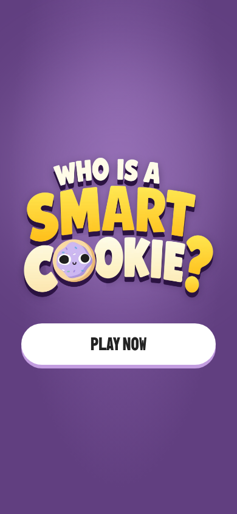
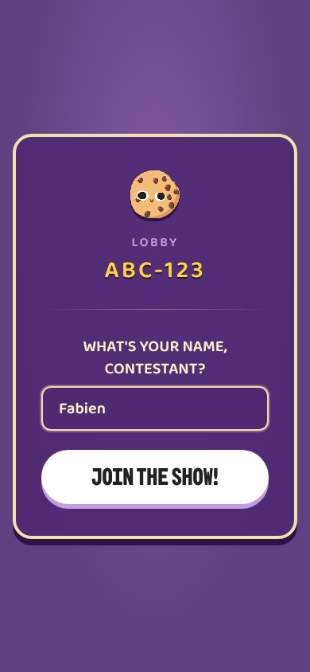
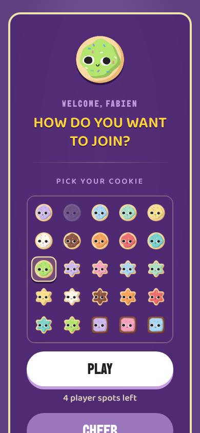
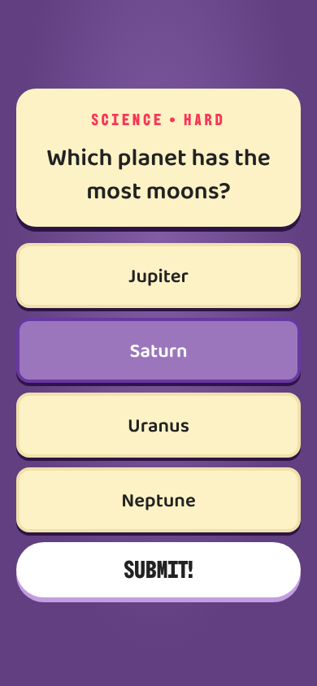
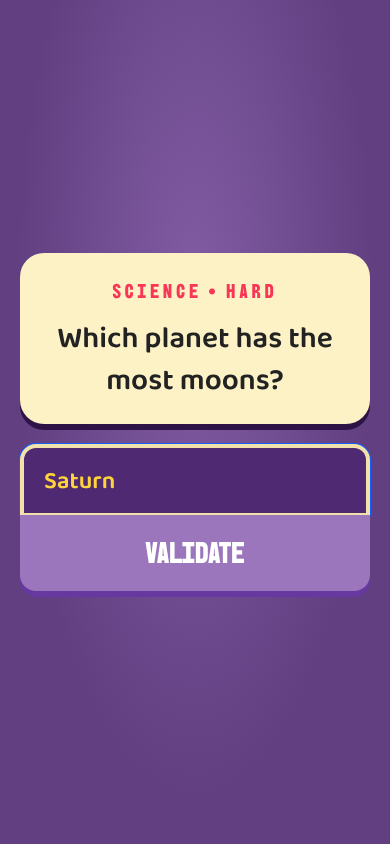
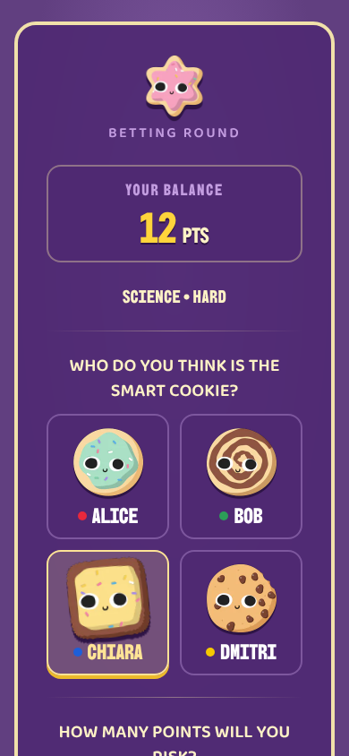

# Who is a Smart Cookie?

A mobile-first trivia game show built with SvelteKit.

## Screens

| Home | Lobby | Pick your cookie | Multiple Choice | Open Answer | Betting |
|------|-------|------------------|-----------------|-------------|---------|
|  |  |  |  |  |  |

## Creating a project

If you're seeing this, you've probably already done this step. Congrats!

```sh
# create a new project
npx sv create my-app
```

To recreate this project with the same configuration:

```sh
# recreate this project
npx sv@0.15.3 create --template minimal --types ts --add prettier eslint vitest="usages:unit,component" playwright tailwindcss="plugins:typography,forms" mcp="ide:claude-code+setup:local" --install npm .
```

## Developing

Once you've created a project and installed dependencies with `npm install` (or `pnpm install` or `yarn`), start a development server:

```sh
npm run dev

# or start the server and open the app in a new browser tab
npm run dev -- --open
```

## Building

To create a production version of your app:

```sh
npm run build
```

You can preview the production build with `npm run preview`.

> To deploy your app, you may need to install an [adapter](https://svelte.dev/docs/kit/adapters) for your target environment.

## Socket.IO Event Reference

The client connects to the server at `VITE_WEBSOCKET_URL` (default `http://localhost:3000`).

Most events are wrapped: `{ data: <payload>, from: <playerId>, to: null }`. The exceptions are **flat events** sent as-is (noted below).

### Client → Server

#### `join-lobby` *(flat)*
Sent when the player submits the join form.
```json
{ "lobbyId": "ABC123", "name": "Fabien" }
```

#### `player-reconnected`
Sent automatically on page reload, so the server can restore state.
```json
{ "message": "Page was refreshed" }
```

#### `submit-answer`
Sent when the player selects and confirms an answer on the multiple-choice screen.
```json
{ "answer": "Au" }
```

#### `submit-open-answer`
Sent when the player validates their text answer on the open-answer screen.
```json
{ "answer": "The assassination of Archduke Franz Ferdinand..." }
```

#### `place-bet`
Sent when the player confirms their bet on the betting screen.
```json
{ "player": "Alice", "amount": 3 }
```

---

### Server → Client

All payloads below are what the client receives after unwrapping. The server can send them either flat or wrapped in `{ data: <payload>, from, lobbyId }` — the client unwraps `data` automatically when present.

#### `connected`
Sent immediately on socket connection. Used to assign the player their socket ID.
```json
{ "from": "<socketId>" }
```

#### `player-joined-lobby`
Sent after the server accepts a `join-lobby` request. Navigates to the loading screen.
```json
{ "id": "<socketId>", "name": "Fabien" }
```

#### `change-screen`
Drives all navigation. The `screen` field determines the route. Additional fields hydrate stores before navigating.

**`loading`** — navigates to `/loading`
```json
{ "screen": "loading", "message": "The game is about to start!" }
```

**`waiting-room`** — navigates to `/loading` with a waiting message (no extra fields needed)
```json
{ "screen": "waiting-room" }
```

**`question`** — navigates to `/question`
```json
{
  "screen": "question",
  "category": "Science",
  "difficulty": "Medium",
  "text": "What is the chemical symbol for gold?",
  "answers": ["Ag", "Au", "Fe", "Cu"]
}
```

**`question-open`** — navigates to `/question-open`
```json
{
  "screen": "question-open",
  "category": "History",
  "difficulty": "Hard",
  "text": "Describe the main causes of the First World War."
}
```

**`bet`** — navigates to `/bet`, populates the player list
```json
{
  "screen": "bet",
  "players": [
    { "id": "<socketId>", "name": "Alice" },
    { "id": "<socketId>", "name": "Fabien" }
  ]
}
```

#### `update-player`
Full sync of the current player's state (e.g. on rejoin or round end).
```json
{ "id": "<socketId>", "lobbyId": "ABC123", "name": "Fabien", "balance": 12 }
```

#### `update-player-state`
Partial sync — only provided fields are merged. Used on reconnection.
```json
{ "balance": 8 }
```

#### `update-players-list`
Updates the list of players in the game (used by the bet screen).
```json
{
  "players": [
    { "id": "<socketId>", "name": "Alice" },
    { "id": "<socketId>", "name": "Fabien" }
  ]
}
```

#### `update-score`
Updates the current player's balance without a full state sync.
```json
{ "balance": 15 }
```

#### `new-message`
Pushes a notification toast that auto-dismisses after 3 seconds.
```json
{ "message": "Alice just went all in!", "author": "Host" }
```

---

## Look & Feel

Everything below lives in `src/lib/styles/theme.css`. Change the look of the whole app from there.

### Fonts

The client uses the same pair as the game:

- **Baloo 2 SemiBold** (`font-body`): all text, including questions, answers, messages, labels and inputs. File: `static/fonts/Baloo2-SemiBold.woff2`, cut down to Latin letters with accents (23 KB) and with the same trimmed line height as the game's copy.
- **BBH Bogle** (`font-display`, capitals only): every action button (`btn`), bet amounts and quick cheers, "Your balance" and the points, player names, and the question's category / difficulty line. File: `static/fonts/BBHBogle-Regular.woff2`.

Both are loaded in `src/app.html` and defined in `src/lib/styles/theme.css`. Their licences are next to them in `static/fonts/`.

### Color Palette

The client uses the game's **Smart Cookie Stage** palette from the Figma design (see the game's README): a purple stage, cream plates and gold podiums. Phone and big screen look like one show.

| Name             | Token                 | Hex       | Usage                                             |
|------------------|-----------------------|-----------|---------------------------------------------------|
| Stage            | `bg-stage`            | `#613f80` | Page background (with a plum spotlight in the middle) |
| Stage Dark       | `bg-stage-dark`       | `#4f2972` | Cards, panels, inputs                             |
| Stage Shadow     | `#2e1446`             | `#2e1446` | Solid shadow under cards, titles and cookies      |
| Plum             | `bg-plum`             | `#825ca4` | Spotlight glow, "reconnecting" banner             |
| Lavender         | `bg-lavender`         | `#9b76bc` | Secondary buttons, picked answers, checkboxes     |
| Lavender Dark    | `bg-lavender-dark`    | `#6838a1` | Shadow under lavender                             |
| Lilac            | `text-lilac`          | `#c39de0` | Small labels, placeholders, toggle borders        |
| Gold             | `bg-gold`             | `#ffe496` | Picked player / bet amount                        |
| Gold Dark        | `bg-gold-dark`        | `#ecba2b` | Shadow under gold                                 |
| Plate            | `border-plate`        | `#f1e1aa` | Card borders, dividers (like the name plates)     |
| Title            | `text-title`          | `#ffd43b` | Big titles and numbers (the logo's yellow)        |
| Cream            | `bg-cream`            | `#fdf2c6` | Question and answer cards, text on purple         |
| Ink              | `text-ink`            | `#222222` | Text on light cards and on the white button       |
| Curtain Red      | `text-curtain-red`    | `#f83756` | Category labels; dark `#cb1b2e` for "disconnected" |
| Game Green       | `bg-game-green`       | `#2c9e58` | Correct / confirm (dark `#1a6638`)                |
| Gray             | `bg-gray`             | `#8b7aa0` | Disabled / inactive states (dark `#5e4d75`)       |

Components use the **semantic tokens**, so you can re-skin the app by pointing them at other colours:

| Semantic token | Points to                | Used for                                      |
|----------------|--------------------------|-----------------------------------------------|
| `background`   | Stage                    | Page                                          |
| `surface`      | Stage Dark               | Toggles, dark panels                          |
| `foreground`   | White                    | Text on purple                                |
| `primary`      | White (shadow Lilac)     | Main button: the game's white pill, ink text  |
| `secondary`    | Lavender                 | Second button ("Cheer"), picked answers       |
| `accent`       | Gold                     | Picked players and bet amounts                |

The home screen shows the game's logo (`static/images/logo.webp`, exported from the game's `menu_logo.png`). The old stars and bursts are gone from every screen. Their images are still in `static/images/` if they come back.

### Cookie avatars

Each player picks a cookie when joining (`AvatarPicker`), and it then replaces the default cookie icon on every screen (`PlayerCookie`) and in the browser tab. Players on the betting screen show their cookie too.

- Previews: `static/images/avatars/<id>.webp` (160 px, 52 cookies). The list is in `src/lib/avatars.json`.
- They are rendered from the game, so they match the big screen exactly. To regenerate them after adding a cookie or glaze colour, run this from the game project: `godot --path . -s res://tools/cookies/render_avatars.gd -- ../who-is-the-smart-cookie-client`
- Glaze colours of the round, star and square cookies: lilac `#cdb8f2`, pink `#f7a3c0`, sky `#a9d8f5`, mint `#a9e0c4`, lemon `#fbe08a`, white `#fff7ec`, chocolate `#8e5440`, orange `#f9a05a`, strawberry `#f06e6e`, teal `#78d6cd`, lime `#b4e66e`.
- A player's colour (the dot next to their name) comes from the game: red, blue, green, yellow, orange, violet, teal or magenta.
